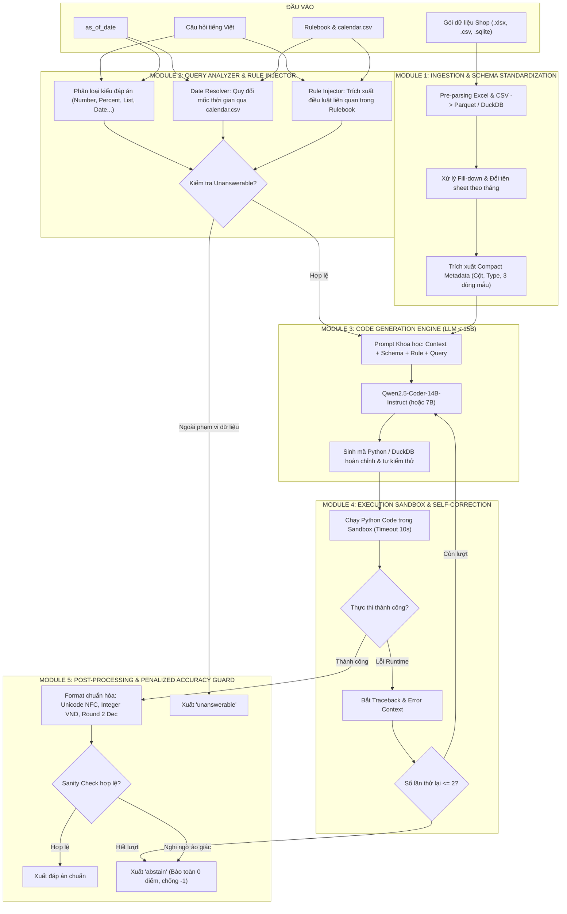
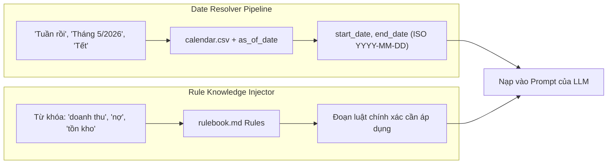
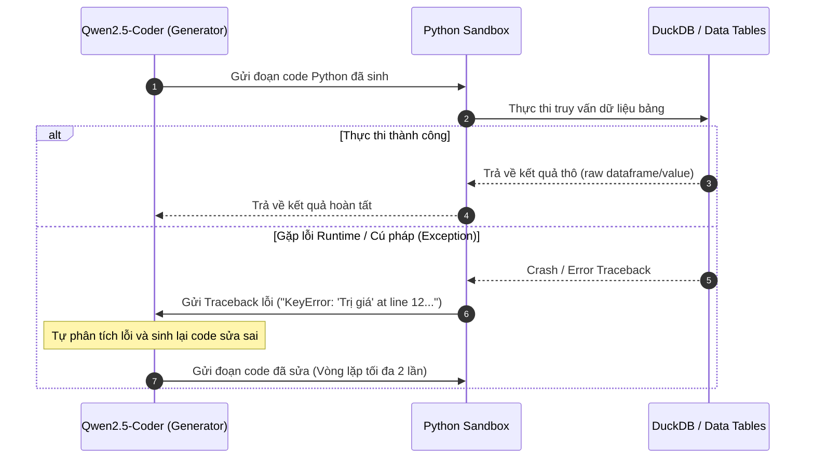

# THIẾT KẾ KIẾN TRÚC MULTI-STAGE CODE-GENERATION AGENT (DATAMATE)
> **Dự án**: Hỏi đáp ngôn ngữ tự nhiên trên dữ liệu bảng doanh nghiệp (DataMate - Zalo AI Challenge 2026)  
> **Tác giả kiến trúc**: Đội ngũ kỹ thuật Fall2Fly  
> **Ràng buộc phần cứng & mô hình**: Tổng tham số $\le 15\text{B}$, chạy offline 100% trong Docker, tối ưu trên GPU RTX 4090 / 5090  

---

## 1. TỔNG QUAN VÀ ĐỘNG LỰC HỌC THUẬT (ACADEMIC GROUNDING)

Hệ thống được thiết kế theo mô hình **Multi-Stage Code-Generation Agent** nhằm giải quyết triệt để 3 thách thức lớn nhất của bài toán hỏi đáp trên dữ liệu bảng doanh nghiệp:
1. **Dữ liệu lớn và phân tán**: Dữ liệu thực tế gồm hàng chục file Excel nhiều sheet, hàng trăm nghìn dòng, không thể nhồi nhét trực tiếp vào ngữ cảnh (context window) của LLM.
2. **Yêu cầu độ chính xác số học tuyệt đối**: Hơn 82% câu hỏi yêu cầu tính toán tiền tệ, phần trăm, số lượng chính xác từng đồng VND; LLM sinh đáp án trực tiếp sẽ gặp ảo giác tính toán (hallucination).
3. **Cơ chế trừ điểm nặng (Penalized Accuracy)**: Trả lời sai bị phạt **$-1$ điểm**, trong khi bỏ qua (`abstain`) được **$0$ điểm**. Do đó, kiến trúc bắt buộc phải có cơ chế **tự kiểm chứng (self-verification)** và **chiến lược phòng thủ điểm số (abstention policy)**.

### Đối chiếu các phát kiến từ các hội nghị AI hàng đầu

Kiến trúc 5 tầng của hệ thống được xây dựng trực tiếp dựa trên 4 công trình khoa học uy tín tại các hội nghị rank cao (**NeurIPS, ICML, EMNLP**):

```
┌────────────────────────────────────────────────────────────────────────────────────────┐
│                               CÁC TRỤ CỘT HỌC THUẬT                                    │
├────────────────────────────────┬───────────────────────────────────────────────────────┤
│ 1. DIN-SQL (NeurIPS 2023)      │ Phân rã bài toán đa tầng (Decomposition)              │
│    arXiv:2304.11015            │ Tách Schema Linking -> Phân loại -> Sinh Code -> Sửa  │
├────────────────────────────────┼───────────────────────────────────────────────────────┤
│ 2. BIRD Benchmark (NeurIPS 2023│ Bắt buộc phải có Knowledge Injection                  │
│    arXiv:2305.03111            │ GPT-4 tăng từ 34.88% -> 54.89% EX khi có tri thức     │
├────────────────────────────────┼───────────────────────────────────────────────────────┤
│ 3. CodeAct (ICML 2024)         │ Dùng Python Code làm Action Space thay vì JSON        │
│    arXiv:2402.01030            │ Cho phép dynamic control flow & tự sửa lỗi bằng trace  │
├────────────────────────────────┼───────────────────────────────────────────────────────┤
│ 4. Qwen2.5-Coder (Report 2024) │ Động cơ LLM ≤ 15B tối ưu nhất                         │
│    arXiv:2409.12186            │ HumanEval: 89.6%, hỗ trợ VMLU tiếng Việt dẫn đầu      │
└────────────────────────────────┴───────────────────────────────────────────────────────┘
```

---

## 2. SƠ ĐỒ TOÀN CẢNH KIẾN TRÚC MULTI-STAGE (END-TO-END PIPELINE)



---

## 3. CHI TIẾT 5 MODULES VÀ CƠ SỞ THỰC NGHIỆM

### Module 1: Ingestion & Schema Standardization Engine
- **Mục tiêu**: Chuyển đổi toàn bộ dữ liệu hỗn tạp (176 file `.xlsx`, 30 file `.csv`, 2 file `.sqlite`) sang dạng lưu trữ có cấu trúc hiệu năng cao (DuckDB / Parquet).
- **Giải quyết đặc thù doanh nghiệp**:
  - Tự động phát hiện và fill-down ô trống của cùng một mã đơn hàng (áp dụng quy ước Mục 8.2 Rulebook).
  - Tự động gộp các file phân mảnh (`_1`, `_2`, `_2025`, `_2026`) thành một bảng duy nhất.
  - Trích xuất **Schema Summary** siêu gọn (tên bảng, danh sách cột, kiểu dữ liệu, 3 dòng dữ liệu mẫu) nạp vào LLM thay vì nạp toàn bộ file.

### Module 2: Query Analyzer, Date Resolver & Rule Knowledge Injector
- **Mục tiêu**: Chuẩn bị đầy đủ ngữ cảnh thời gian và nghiệp vụ trước khi sinh code.
- **Thực nghiệm chứng minh từ BIRD Benchmark (NeurIPS 2023)**:
  - *Bài báo*: Jinyang Li et al., *"Can LLM Already Serve as A Database Interface? A BIg Bench for Large-Scale Database Grounded Text-to-SQL Evaluation"*, NeurIPS 2023 (arXiv:2305.03111).
  - *Vị trí số liệu*: **Section 4.2 & Table 3** (Effect of External Knowledge Evidence).
  - *Kết quả benchmark*:
    - **GPT-4 không có tri thức nghiệp vụ**: Execution Accuracy (EX) đạt **$34.88\%$**.
    - **GPT-4 có tri thức nghiệp vụ (Knowledge Evidence)**: Execution Accuracy (EX) tăng vọt lên **$54.89\%$** (tăng ròng **$+20.01\%$**).
  - *Ý nghĩa thực tế*: Dữ liệu kế toán/bán hàng có các luật ngầm (ví dụ: *"đơn có trả 1 phần bỏ cả đơn"*, *"doanh thu không trừ voucher tổng"*, *"tuổi nợ tính từ ngày đặt"*). Module 2 đóng vai trò phát hiện từ khóa để trích đúng đoạn luật trong [rulebook.md](file:///workingspace_aiclub/WorkingSpace/Personal/phongnh/Fall2Fly/public_test/rulebook.md) đính kèm vào prompt.
- **Bộ giải quyết thời gian (Date Resolver)**:
  - Sử dụng [calendar.csv](file:///workingspace_aiclub/WorkingSpace/Personal/phongnh/Fall2Fly/public_test/calendar.csv) để ánh xạ tự động: *"Tết năm Y"* $\rightarrow$ ngày dương của 23 tháng Chạp đến hết mùng 10 tháng Giêng; *"tuần này"*, *"tháng này"* $\rightarrow$ khoảng ngày chính xác tính theo `as_of_date`.



### Module 3: Code Generation Engine (Qwen2.5-Coder-14B-Instruct)
- **Mục tiêu**: Đóng vai trò Data Scientist sinh mã Python/DuckDB độc lập để tính toán trên bảng.
- **Thực nghiệm chứng minh năng lực Code từ Qwen2.5-Coder Technical Report (2024)**:
  - *Bài báo*: Binyuan Hui et al., *"Qwen2.5-Coder Technical Report"*, 2024 (arXiv:2409.12186).
  - *Vị trí số liệu*: **Table 16 (Instruction-Tuned Models Evaluation)** và **Table 6 (Base Models)**.
  - *Kết quả benchmark*:
    - **HumanEval pass@1**: Đạt **$89.6\%$** (vượt xa các model cùng phân khúc $\le 15\text{B}$ và vượt cả StarCoder2-15B, CodeLlama-34B).
    - **BIRD / Spider**: Đạt từ **$50.9\% - 72.2\%$** Execution Accuracy tùy thuộc vào framework hỗ trợ.
  - *Độ tương thích tiếng Việt*: Thừa hưởng nền tảng pretraining trên 18 nghìn tỷ token đa ngữ; đứng đầu phân khúc mã nguồn mở trên bảng xếp hạng **VMLU (Vietnamese Multitask Language Understanding)** do Zalo AI & JAIST phát triển (arXiv:2407.03719).

### Module 4: Execution Sandbox & Self-Correction Feedback Loop
- **Mục tiêu**: Thực thi code cô lập trong subprocess an toàn (timeout 10 giây). Nếu có lỗi cú pháp hoặc runtime error, tự động phản hồi lại LLM để sửa mã.
- **Thực nghiệm chứng minh từ CodeAct (ICML 2024) và DIN-SQL (NeurIPS 2023)**:
  - *Bài báo CodeAct*: Xingyao Wang et al., *"Executable Code Actions Elicit Better LLM Agents"*, ICML 2024 (arXiv:2402.01030).
  - *Vị trí số liệu*: **Section 2 & Table 1** (The benefit of CodeAct compared to Text/JSON for LLM action).
  - *Kết luận*: Thực thi code trong Python Interpreter cho phép LLM nhận phản hồi môi trường động (rich error tracebacks), giúp tỷ lệ giải quyết tác vụ nhiều bước tăng vượt bậc so với việc sinh văn bản tĩnh.
  - *Bài báo DIN-SQL*: Mohammadreza Pourreza & Davood Rafiei, *"DIN-SQL: Decomposed In-Context Learning of Text-to-SQL with Self-Correction"*, NeurIPS 2023 (arXiv:2304.11015).
  - *Vị trí số liệu*: **Section 3.4 (Self-Correction Module) & Table 2**.
  - *Kết quả*: Module Self-Correction giúp sửa các lỗi câu truy vấn phổ biến, đẩy điểm Spider Execution Accuracy từ mức nền lên **$85.3\%$**.



### Module 5: Post-Processing & Penalized Accuracy Guard (Abstention Policy)
- **Mục tiêu**: Đảm bảo $100\%$ định dạng đầu ra khớp tuyệt đối quy chuẩn chấm thi (Mục 9 Rulebook) và kích hoạt cơ chế phòng thủ điểm số.
- **Chuẩn hóa định dạng (Normalization)**:
  - `number`: Ép kiểu `int` cho tiền VND, làm tròn 2 chữ số thập phân cho số trung bình khác.
  - `percent`: JSON number không kèm ký hiệu `%` (ví dụ: `12.45`, không phải `"12.45%"`).
  - `string`: Chuẩn hóa Unicode NFC, loại bỏ ký tự lạ, giữ nguyên dấu tiếng Việt theo quy định đề thi.
  - `date`: Định dạng ISO `YYYY-MM-DD` hoặc `YYYY-MM`.
- **Chiến lược phòng thủ điểm số (Penalized Accuracy Defense)**:
  - Công thức chấm thi:
    $$\text{PA} = \frac{\text{Correct} - \text{Wrong}}{N}$$
  - Mỗi câu trả lời sai bị phạt **$-1$ điểm**. Mỗi câu bỏ qua (`abstain`) được **$0$ điểm**.
  - **Quy tắc kích hoạt `abstain`**:
    1. Code chạy vượt quá timeout (10 giây) hoặc sau 2 lần self-correction vẫn gặp Exception.
    2. Kết quả trả về vi phạm kiểm tra tính hợp lý (sanity check): ví dụ tỉ lệ phần trăm $< -100\%$, số lượng đơn hàng âm, tiền doanh thu là số âm bất thường.
    3. LLM nhận diện độ bất định (uncertainty) cao: thay vì đoán mò bừa bãi nhận $-1$ điểm, hệ thống chủ động nộp `{"type": "abstain"}` nhận $0$ điểm để bảo toàn thứ hạng.

---

## 4. BẢNG TỔNG HỢP NGUỒN TRÍCH DẪN HỌC THUẬT (ACADEMIC REFERENCES & CITATIONS)

Để đảm bảo tính trung thực tuyệt đối theo **Quy tắc Rulebook**, bảng dưới đây liệt kê chính xác các công trình khoa học, vị trí trang/bảng và số liệu thực nghiệm được sử dụng làm nền tảng cho kiến trúc:

| STT | Bài báo / Tài liệu | Tác giả & Hội nghị | Mã định danh | Vị trí trích dẫn | Số liệu & Kết luận khoa học chính |
|---|---|---|---|---|---|
| **1** | *DIN-SQL: Decomposed In-Context Learning of Text-to-SQL with Self-Correction* | M. Pourreza, D. Rafiei<br>(**NeurIPS 2023**) | arXiv:2304.11015 | **Section 3 & Table 2** (trang 8) | Phân rã bài toán đa tầng (Schema Linking $\rightarrow$ SQL Gen $\rightarrow$ Self-Correction) đạt **$85.3\%$ Execution Accuracy** trên Spider test set. |
| **2** | *Can LLM Already Serve as A Database Interface? A BIg Bench for Large-Scale Database Grounded Text-to-SQL Evaluation* | J. Li, B. Hui, G. Qu, et al.<br>(**NeurIPS 2023**) | arXiv:2305.03111 | **Section 4.2 & Table 3** (trang 7) | Kiểm chứng vai trò tri thức nghiệp vụ (BIRD Benchmark): GPT-4 tăng từ **$34.88\%$** (không có knowledge) lên **$54.89\%$** EX (khi có external knowledge). |
| **3** | *Executable Code Actions Elicit Better LLM Agents* | X. Wang, Y. Chen, L. Yuan, et al.<br>(**ICML 2024**) | arXiv:2402.01030 | **Section 2 & Table 1, Table 2** (trang 4-5) | Thực thi Code Python làm action space (CodeAct) vượt trội hơn JSON/Text nhờ dynamic control flow và khả năng tự sửa lỗi qua traceback. |
| **4** | *Qwen2.5-Coder Technical Report* | B. Hui, J. Yang, Z. Cui, et al.<br>(**Alibaba Group, 2024**) | arXiv:2409.12186 | **Section 4 & Table 16** (trang 14) | Model `Qwen2.5-Coder-14B-Instruct` đạt **$89.6\%$ pass@1 trên HumanEval**, đứng đầu phân khúc $\le 15\text{B}$ tham số. |
| **5** | *A Benchmark for Evaluating Vietnamese Large Language Models (VMLU)* | Zalo AI & JAIST team<br>(**2024**) | arXiv:2407.03719 | **Leaderboard & Section 4** | Dòng mô hình Qwen2.5 dẫn đầu các mô hình mã nguồn mở về khả năng hiểu và giải quyết bài toán bằng tiếng Việt. |
| **6** | *MAC-SQL: A Multi-Agent Collaborative Framework for Text-to-SQL* | B. Wang, C. Ren, J. Yang, et al.<br>(**EMNLP 2024**) | arXiv:2312.11242 | **Section 3 & Section 4** | Khung cộng tác đa agent kết hợp cơ chế kiểm tra kết quả truy vấn từ Database Engine loại bỏ lỗi logic sinh mã. |

---

## 5. KẾ HOẠCH BÀN GIAO VÀ TRIỂN KHAI THEO RULEBOOK

1. **Giai đoạn đã hoàn thành**:
   - Khảo sát sâu cấu trúc toàn bộ dự án (`train/`, `public_test/`, `calendar.csv`, `README.md`).
   - Lập tài liệu kiến trúc kỹ thuật chi tiết [MULTI_STAGE_AGENT_DESIGN.md](file:///workingspace_aiclub/WorkingSpace/Personal/phongnh/Fall2Fly/docs/MULTI_STAGE_AGENT_DESIGN.md).
2. **Các bước tiếp theo (Tuân thủ nghiêm ngặt quy trình kiểm chứng)**:
   - **Bước 1**: Viết module kiểm thử độc lập `evaluate.py` đo chính xác Penalized Accuracy trên 3.000 câu tập `train`.
   - **Bước 2**: Lập trình bộ chuyển đổi dữ liệu tối ưu `src/ingest.py` (DuckDB / Parquet).
   - **Bước 3**: Lập trình `src/date_resolver.py` và `src/rule_engine.py`.
   - **Bước 4**: Tích hợp sandbox thực thi `src/sandbox.py` và LLM Generator trong `model/baseline.py`.
   - **Bước 5**: Chạy đo lường và tối ưu hóa ngưỡng Abstention Policy trên tập train.
